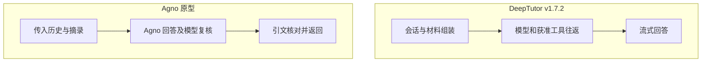
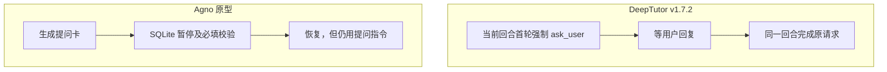
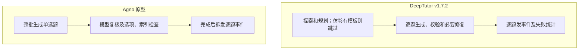
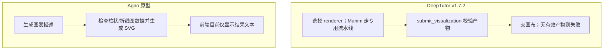
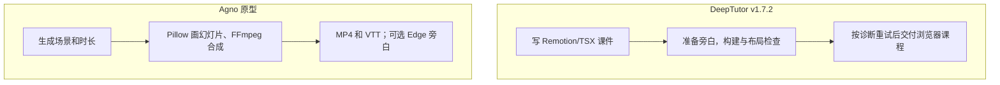
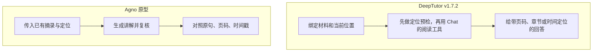
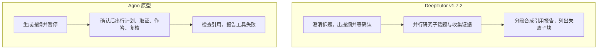
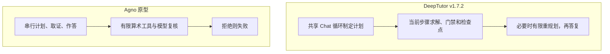
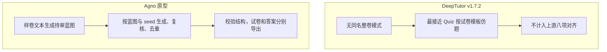

# DeepTutor × Agno：能力流程对照

> 这是早期原型的流程对照快照。当前实现、离线验收与未复现项见 [Agno 行为对照](agno-parity.md)。

Capability 是 DeepTutor 面向用户的核心入口；底层真正要对齐的是运行流程：用哪些工具、在哪里等用户、怎么检查结果、失败如何恢复，以及前端看到什么事件。不只是八个提示词，也不是八套独立 API。

以 DeepTutor v1.7.2 固定源码对照当前原型。读图从左到右，不表示耗时。本次只做静态核查；42 项离线测试是已有记录，使用真实 Agno 编排、模拟模型响应，尚未做真实模型或浏览器端到端验收。

## 共用主干

DeepTutor：回合服务 → 组装上下文 → 工具循环或专用流水线 → WebSocket。Agno 原型：FastAPI → SQLite 状态与事件 → Workflow → 校验/产物 → SSE。中间有步骤与工具轨迹，数值进度主要是 10% 和 100%，不是预计耗时。

[上游回合服务](https://github.com/HKUDS/DeepTutor/blob/60fb3bdfddb30b7740c7ce3bd9b28d908f2af6db/deeptutor/services/session/turns/executor.py) · [原型任务执行](../backend/app/main.py#L61-L102) · [官方能力说明](https://docs.deeptutor.info/zh-cn/explore/chat-workspace/)

## 01 · Chat

**关键差异：** 白名单工具较少，未接完整附件与工作区；复核拒绝即失败。

[上游固定源码](https://github.com/HKUDS/DeepTutor/blob/60fb3bdfddb30b7740c7ce3bd9b28d908f2af6db/deeptutor/agents/chat/agentic_pipeline.py) · [原型源码](../backend/app/agno_adapter.py#L164-L210)

## 02 · Ask Questions

**关键差异：** 恢复可能再次出卡而不是完成原任务。离线演示用固定卡片；这次只记录缺口，不改功能。

[上游固定源码](https://github.com/HKUDS/DeepTutor/blob/60fb3bdfddb30b7740c7ce3bd9b28d908f2af6db/deeptutor/capabilities/ask_questions/capability.py) · [原型源码](../backend/app/main.py#L61-L92)

## 03 · Quiz

**关键差异：** 不是边生成边出题。题目结构合法不等于数学正确。

[上游固定源码](https://github.com/HKUDS/DeepTutor/blob/60fb3bdfddb30b7740c7ce3bd9b28d908f2af6db/deeptutor/agents/question/pipeline.py#L515-L613) · [原型源码](../backend/app/core.py#L50-L58)

## 04 · Visualize

**关键差异：** HTML、SVG、Mermaid、Manim 的模型源码不执行。已有几何图样张为独立制作，未接实时联动或自动出卷。

[上游固定源码](https://github.com/HKUDS/DeepTutor/blob/60fb3bdfddb30b7740c7ce3bd9b28d908f2af6db/deeptutor/visualizers/tool.py#L64) · [原型源码](../backend/app/visualize.py)

## 05 · Video Lesson

**关键差异：** 已实际生成带字幕 MP4，不是上游浏览器课件；真实旁白未联测，无同等构建修复循环。

[上游固定源码](https://github.com/HKUDS/DeepTutor/blob/60fb3bdfddb30b7740c7ce3bd9b28d908f2af6db/deeptutor/agents/video_lesson/capability.py#L20-L245) · [原型源码](../backend/app/media.py#L66-L159)

## 06 · Immersive Reading

**关键差异：** 独立脚本可抽取文本层 PDF 或已有字幕；任务 API 没有原文旁读、扫描件 OCR、音视频转录、导航或批注。

[上游固定源码](https://github.com/HKUDS/DeepTutor/blob/60fb3bdfddb30b7740c7ce3bd9b28d908f2af6db/deeptutor/capabilities/reading/tools.py) · [原型源码](../backend/app/core.py#L27-L48)

## 07 · Research

**关键差异：** 原型本地用词法检索，外部检索未联测；无向量索引及研究块级并发。上游确认前不启动主研究，不代表预览绝不调工具。

[上游固定源码](https://github.com/HKUDS/DeepTutor/blob/60fb3bdfddb30b7740c7ce3bd9b28d908f2af6db/deeptutor/agents/research/pipeline.py#L565-L720) · [原型源码](../backend/app/agno_adapter.py#L176-L207)

## 08 · Solve

**关键差异：** 未实现步骤门禁或重规划。上游默认最多重规划两次、单个计划最多十二步，仍不是形式化数学证明。

[上游固定源码](https://github.com/HKUDS/DeepTutor/blob/60fb3bdfddb30b7740c7ce3bd9b28d908f2af6db/deeptutor/capabilities/solve/tools.py) · [原型源码](../backend/app/agno_adapter.py#L176-L194)

## 09 · Exam（扩展）

**关键差异：** 目前只导 JSON 或文本；待审为提示，未强制审核凭据。未验真实文风、难度、答案或 seed 可复现；TikZ/PDF 未接入。

[上游固定源码](https://github.com/HKUDS/DeepTutor/blob/60fb3bdfddb30b7740c7ce3bd9b28d908f2af6db/deeptutor/agents/question/pipeline.py#L515-L613) · [原型源码](../backend/app/exam_blueprint.py#L130-L199)

## 先补什么

优先修 Ask Questions 的恢复闭环，再接 Exam 的几何验算 → TikZ → PDF；然后补 Solve 步骤门禁和 Quiz 逐题生成。SQLite 运行记录不是长期记忆；记忆设计留到下一轮。
