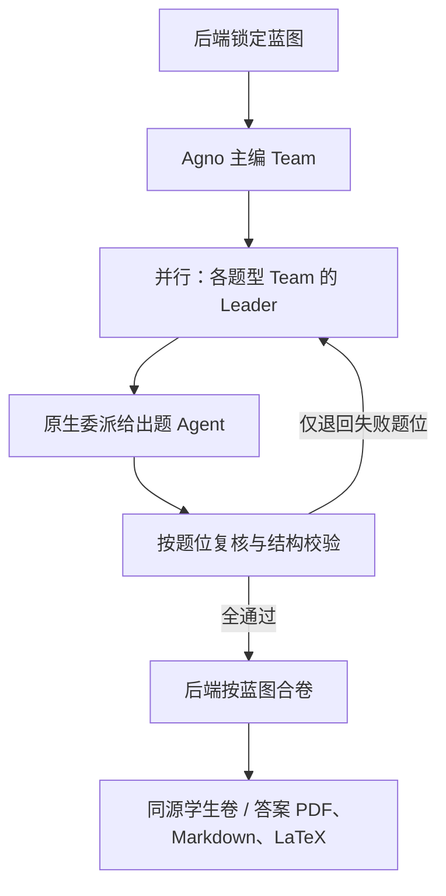

# Exam：按题型分队出卷

## 卷面蓝图与职责

应用先校验蓝图。每个题位由「分区 ID + 题号」标识，保留题型、分值、选项标签、风格要求和顺序。样卷的题干只用于已存在的重复检测，不是照抄来源。新课标Ⅰ卷样式示例为 8 单选、3 多选、3 填空、5 解答，150 分、120 分钟。

- **主编组织，各题型 Leader 分题。** 以真实 Agno 委派和成员运行输出为准，不接受 Leader 只写「已分派」。不以主编自由写下的题号、分值或最终卷面替换蓝图。
- **题位验收。** 单选和多选要分别符合答案标签规则；填空与解答的答案不自动当成已形式化证明。复核调用与出题调用独立，不承诺模型不犯错。未知题位、重复题位或结果不足不能当作成功。
- **合卷和导出是后端职责。** 输出边界与旧版相同。学生 PDF/Markdown 不含答案，不执行模型提供的 TeX；受控图形模板和任意图形题是两件事。记忆和个性化尚未接入。
- **前端只消费进度。** SSE 记录委派、组任务、题位状态与复验进度，不将模型推理、口令或答案作为轨迹事件。

## 默认高考命题梯度

[版本化策略与提示词](../backend/app/exam_difficulty.py)负责分配，团队和返工由 [exam_teams.py](../backend/app/exam_teams.py) 执行。对 8/3/3/5 的参考体例，按各题型内的顺序安排，不改变题型、分值、题号或 canonical 输出：

| 题型 | 基础 | 中档 | 提升 | 压轴 |
| --- | --- | --- | --- | --- |
| 单选 | 1–4 | 5–7 | 8 | — |
| 多选 | — | 9 | 10 | 11 |
| 填空 | 12 | 13 | 14 | — |
| 解答 | — | 15 | 16–17 | 18–19 |

基础题考核心概念或直接方法；中档题要组合判断或步骤；提升题需要跨概念、分类、等价变形或建模；压轴题应有非显然的关键一步，不靠冗长计算。解答题保留梯度，不能把第一问也设计成无从入手。相同难度目标会传给题型 Leader、出题成员、独立求解/复核，修题不会把题位降级。其他题量按题型内部顺序等比例取档。蓝图中的风格要求仍保留。这些是**命题和审阅目标**，不是经过真实考生数据校准的难度指标。

## 启动、限额和轨迹

真实模式仍使用 `POST /api/tasks`、`capability: "exam"`、`provider: "agno"`。输入保持 `blueprint`、`seed`、`prompt` 和可选 `artifacts: {"version": 1}`。不能通过请求追加任意工具。真实请求显式设置服务端 `AGNO_MODEL`（团队 Exam 未设时默认 `gpt-6-luna`）。服务端默认 `AGNO_EXAM_MODE=teams`，若需对照或回退，显式设为 `legacy`；遇到失败不会悄悄换回旧版。

团队版最多 30 个题位、6 类题型，每题最多初稿及一次针对性返工。主编调度各题型 Team，外层 Workflow 用受限的 Parallel 分组复核：组间并行、单组按题位推进。独立求解步骤看题和选项，不先看出题人的答案；后续复核比较两边结论。题位修复不会重跑已接受的题。初始委派不完整、异常、最终合卷冲突仍可能拦截整卷，不发布半成品。框架有单次请求输出和超时范围，**不等于整个任务有美元硬上限**。

`exam.team.*`、`exam.delegation.*` 和 `exam.slot.*` 记录分队、委派、验收和返工；公共 `progress` 事件驱动原进度条。轨迹不是模型内部推理。Luna 的带委派工具阶段使用 Chat Completions，显式关闭该请求的 reasoning；不要误配成 Chat Completions + 工具 + high。

## 验证口径

旧版的真实 Luna 大模型记录只证明「整卷生成 → 整卷复核」两步骤能运行。第一次复核拒绝错误答案；第二次通过后，原始输出在不呼叫模型的情况下用修复后的校验、排版链路重放。团队版用真实 Agno 3.2.0 编排、替换 HTTP 响应回归：无返工的 19 题用例有 52 次模拟请求。这个数包括主编及题型队长的工具往返、4 次出题成员调用和逐题求解/复核，不是实际在线用量，分派与返工会改变请求数。不能以旧版卷证明团队版线上质量、延迟或成本。
